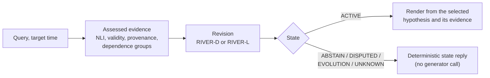

# Method

RIVER is a post-retrieval revision layer. It receives competing hypotheses and
assessed evidence, and decides which proposition should govern the system's
current belief, or whether to abstain, preserve a dispute or represent genuine
change. Generation happens only after that decision.



## Transaction time and valid time

Every evidence item carries two times:

- **Transaction time** (`transaction_time`, mapped to `observed_at` at run time):
  when the item entered memory.
- **Valid time** (`valid_time`): the interval over which its proposition holds.

Transaction time is retained for auditing only. Neither RIVER variant uses
arrival rank, list position, turn position or a last-mentioned flag. The
configurations `river_plus_arrival` and `river_l_plus_arrival_negative_control`
add arrival information deliberately, as negative controls.

## Revision states

| State | Meaning |
|---|---|
| `ACTIVE` | One hypothesis is supported and valid at the target time; it is selected |
| `ABSTAIN` | The evidence is insufficient to license a decision |
| `DISPUTED` | Independently supported, incompatible hypotheses remain in conflict |
| `EVOLUTION` | Supported values hold over non-overlapping valid times |
| `UNKNOWN` | The available evidence cannot determine the requested fact |

Competing hypotheses and historical evidence are kept in a non-destructive
ledger (`river/ledger.py`) rather than overwritten.

## RIVER-D (deterministic)

`river/revision.py`. For evidence item *e* supporting hypothesis *h*:

```
contrib(e; τ) = θ(e; τ) · ρ(e) · γ(e) · δ(e) · (p_ent(e) − λ · p_con(e))
```

- θ: validity factor, the interval confidence if the target time τ lies in the
  valid interval, else 0 (the interval confidence alone when no τ is given);
- ρ: provenance reliability; γ: extraction confidence; λ = 1;
- δ = 1/√n_g: repetition discount for the n_g items sharing an independence
  group.

Hypothesis scores sum their contributions. The operator checks abstention first,
then disjoint well-supported intervals (`EVOLUTION`), then the top-two margin
(`DISPUTED`); a remaining score below the support threshold gives `UNKNOWN`, and
other supported cases give `ACTIVE`.

Thresholds are fitted on the dev split (`scripts/release/tune_river_d.py`). The
frozen configuration selects support, margin and abstention thresholds of 0.02
each; because support equals abstention, the `UNKNOWN` branch is unreachable in
that configuration. Each mechanism can be switched off for ablation
(`configs/ablations/`).

## RIVER-L (learned)

`river/learned/`. A small Deep Sets network trained from scratch, not a
pretrained language model.

1. A shared two-layer MLP encodes each evidence item from 14 features: three NLI
   probabilities; temporal applicability, interval uncertainty, has-start,
   has-end and normalised interval width; provenance reliability; extraction
   confidence; independence-group fraction and dependence discount; and two
   evidence-availability indicators (`features.py`).
2. A masked mean pools items per hypothesis.
3. A hypothesis head scores each candidate. Mean and max summaries across
   hypotheses, with two global density indicators, feed a five-way state head
   and a sigmoid confidence head (`model.py`).

Shared encoding with symmetric pooling makes the output invariant to any
permutation of the evidence that preserves each item's hypothesis association.

Training (`losses.py`, `train.py`) minimises

```
L = L_rev + λ_inv · L_inv + λ_upd · L_upd + λ_cal · L_cal
```

state and hypothesis cross-entropy; an order-consistency term between the
original and an arrival-permuted copy of each batch; an update-focused term on
supported updates; and squared confidence error against joint correctness.
Weights (λ_inv, λ_upd, λ_cal) = (1, 1, 0.1), hidden size 32, no dropout, batch
16, AdamW at learning rate 0.01, at most 100 epochs with early stopping
(patience 10) on the dev split. Seeds: 11, 42, 101, 202, 314. Configuration:
`configs/learned/river_l_full.json`.

## Selected-evidence rendering

For an `ACTIVE` decision, the generator (`qwen3.5:4b` in the released results)
receives the question, the selected hypothesis and only that hypothesis's
admissible evidence, and must answer as `FINAL_ANSWER: <answer>`. Non-active states return
a fixed, state-appropriate reply and never call the generator. This separates
whether the system chose the right belief from whether the generator expressed
it (`experiments/run.py`, `generation_context` and `render_answer`).
